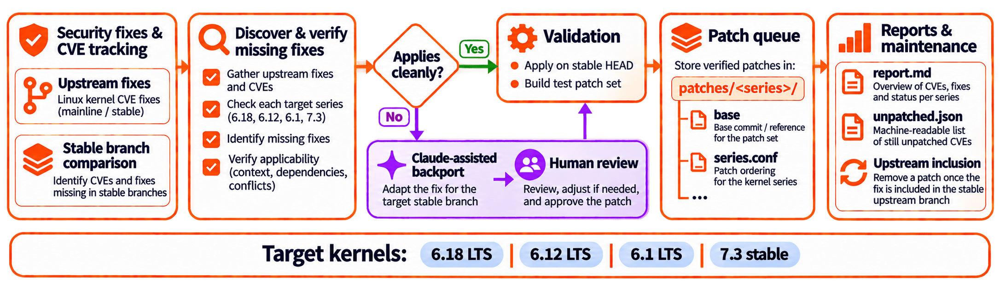

<h2 align="center">
  <a href=#></a>
  <br><br>
</h2>

# Armbian Kernel Security Fixes

**Remember [SETI@home](https://en.wikipedia.org/wiki/SETI@home)?** You gave spare computing power to a good cause.
Now put your own Claude to work for open-source security.

Help backport Linux kernel CVE fixes to stable kernels. AI does the heavy lifting. Humans review.

> [!TIP]
> **Contribute with Claude.** Paste this prompt into Claude Code:
>
> ```
> get https://github.com/armbian/cve and contribute
> ```

## Why help

A kernel CVE fix lands in mainline first. Older stable kernels get it later, and some fixes do not apply to them at all. Devices run these kernels for years.

This repository closes the gap for the LTS kernels **6.1**, **6.12** and **6.18**, and the newest stable, **7.3**. Most fixes apply cleanly and ship automatically. The rest need a backport. That is where your Claude helps.

## How it works



1. Every 15 minutes, a CI job checks the upstream kernel sources for new CVE fixes.
2. Fixes that apply cleanly go into the patch set. Every series is build-tested on arm64, arm, riscv and x86.
3. Fixes that do not apply go to the open list. Contributors run Claude Code on them, and each backport becomes a pull request.
4. A person reviews each backport before it is merged.
5. A fix leaves the patch set when the stable kernel carries it.

## Contribute in three steps

```
git clone https://github.com/armbian/cve.git
cd cve
claude
> /contribute
```

1. Claude Code checks your setup and lists the open CVEs.
2. You pick the CVEs. Claude makes the backports and reviews them with you.
3. Claude asks before it pushes and opens a pull request with only the CVEs you approve.

You need Linux, about 10 GB of free disk space and [Claude Code](https://docs.claude.com/en/docs/claude-code). One CVE takes 1–3 minutes and about $0.30–1.00 of your Claude plan usage.

Full steps, also by hand: [CONTRIBUTING.md](CONTRIBUTING.md).

## Questions

**When are patched kernels released?**
Beta kernels get the fixes at the next CI run. Stable kernels get them every Monday.

**Does Claude write new security fixes?**
No. Every fix comes from upstream: the kernel CVE records, the stable queue, mainline and the stable mailing list. Claude only adapts an existing fix to an older kernel.

**Does Claude work without me?**
No. Claude runs only when you start it, and only on the CVEs you pick. Nothing is pushed without your approval.

**Do I need kernel experience?**
It helps. You review each backport before you submit it. Leave out a backport that you do not understand, or say so in the pull request. A maintainer reviews it again.

**Do I need a board to test on?**
No. CI builds each patch for four architectures. If you test on a board, name it in the pull request.

**Is a CVE already covered?**
Run `./fasttrack.sh why CVE-2026-1234`. It tells you why a CVE is or is not in the patch set.

## More

- Current status per kernel series: [report.md](report.md)
- Latest backport results: [cve-report.md](cve-report.md)
- Patch releases: [Releases](https://github.com/armbian/cve/releases)
- How the tool works, and how to use the patches: [DEVELOPMENT.md](DEVELOPMENT.md)
- CI status: <https://actions.armbian.com/?repo=cve>
- Armbian: <https://www.armbian.com> · Documentation: <https://docs.armbian.com>
